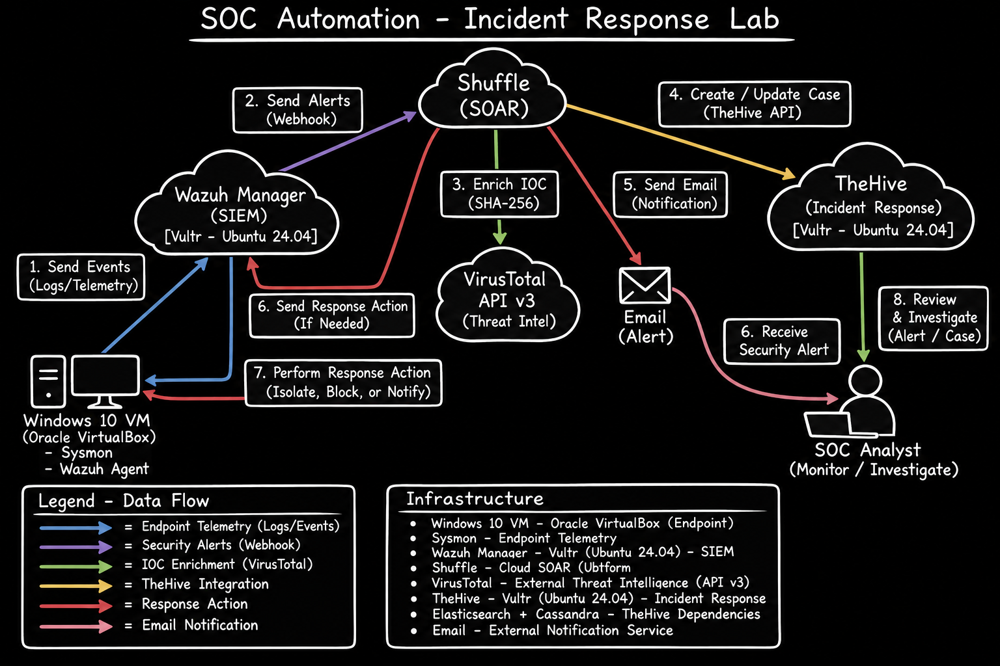

# SOC Automation, Threat Detection & Incident Response Lab

## Project Overview

This project demonstrates the design, deployment, and implementation of an end-to-end Security Operations Center (SOC) automation environment. The lab integrates endpoint monitoring, Security Information and Event Management (SIEM), Security Orchestration, Automation and Response (SOAR), threat intelligence, and incident management technologies.

The environment was developed using Oracle VirtualBox, Windows 10, Sysmon, Wazuh SIEM, Shuffle SOAR, VirusTotal API v3, and TheHive, supported by Ubuntu 24.04 LTS cloud infrastructure, Elasticsearch, and Apache Cassandra.

To validate the environment, I executed Mimikatz in a controlled Windows 10 virtual machine and observed corresponding Sysmon security events and Wazuh alerts. These alerts were forwarded to Shuffle SOAR, where I configured an automated workflow incorporating SHA-256 file hash processing, VirusTotal threat intelligence enrichment, TheHive integration, and email notifications.

## Project Objectives

- Build and configure a virtualized Windows 10 endpoint for security monitoring.
- Deploy Sysmon to collect detailed Windows security telemetry.
- Configure Wazuh SIEM to collect, monitor, and analyze endpoint security events.
- Deploy TheHive with Elasticsearch and Apache Cassandra to support incident management.
- Develop a Shuffle SOAR workflow using webhooks and VirusTotal API v3.
- Automate threat intelligence enrichment using SHA-256 file hash indicators.
- Configure automated security notifications through email.
- Simulate suspicious endpoint activity using Mimikatz in a controlled environment.
- Validate the detection and automation pipeline through Sysmon events, Wazuh alerts, and Shuffle workflow execution.

## Technologies Used

| Technology | Purpose |
|---|---|
| Oracle VirtualBox | Virtual machine management |
| Windows 10 (64-bit) | Endpoint operating system |
| Sysmon | Windows endpoint monitoring |
| Wazuh SIEM | Security event monitoring and alert generation |
| Shuffle SOAR | Security orchestration and automation |
| VirusTotal API v3 | Threat intelligence enrichment |
| TheHive | Incident response and case management |
| Elasticsearch | Search and indexing infrastructure |
| Apache Cassandra | Database infrastructure |
| Ubuntu 24.04 LTS | Cloud server operating system |
| Vultr | Cloud infrastructure provider |
| PowerShell | File integrity verification and administration |
| Mimikatz | Controlled credential-access security testing |

## Project Architecture

The SOC environment follows a security monitoring and automation workflow:

**Windows 10 Endpoint → Sysmon → Wazuh SIEM → Shuffle SOAR → VirusTotal / TheHive / Email Notifications**

The workflow demonstrates how endpoint activity can be monitored, analyzed, and processed through automated security operations.

### SOC Architecture Diagram

## Implementation Documentation

- [Phase 1: Windows 10 VM and Sysmon Setup](documentation/01-windows-sysmon-setup.md)
- [Phase 2: Wazuh SIEM Deployment](documentation/02-wazuh-deployment.md)
- [Phase 3: TheHive Incident Response Deployment](documentation/03-thehive-deployment.md)
- [Phase 4: Shuffle SOAR Automation](documentation/04-shuffle-automation.md)
- [Phase 5: Mimikatz Detection and Security Investigation](documentation/05-mimikatz-detection.md)
## Project Results

This SOC automation lab demonstrated the integration of endpoint monitoring, security event detection, and automated incident notification within a controlled environment.

### Key Accomplishments

- **Endpoint Monitoring:** Deployed a Windows 10 virtual machine with Sysmon and a Wazuh agent to collect and forward endpoint security telemetry.
- **SIEM Deployment:** Configured Wazuh on an Ubuntu 24.04 LTS cloud server to monitor endpoint activity and generate security alerts.
- **Threat Detection:** Executed Mimikatz in an isolated testing environment and observed corresponding security events and Wazuh alerts.
- **Security Automation:** Configured a Shuffle SOAR workflow to receive Wazuh alerts through a webhook and process SHA-256 file hashes.
- **Threat Intelligence:** Integrated VirusTotal API v3 into the Shuffle workflow to support file-hash reputation lookups.
- **Incident Management:** Deployed TheHive with Elasticsearch and Apache Cassandra and configured its integration with Shuffle.
- **Automated Notifications:** Verified that Shuffle successfully delivered an email notification associated with the security alert.

### Skills Demonstrated

- Security Information and Event Management (SIEM)
- Security Orchestration, Automation, and Response (SOAR)
- Endpoint Monitoring and Log Analysis
- Security Alert Investigation
- Threat Intelligence Integration
- Incident Response Workflows
- Linux Server Administration
- Cloud Infrastructure Deployment
- Windows Event Analysis
- Technical Troubleshooting and Documentation

### Project Scope

This project was developed as a personal cybersecurity home lab for educational and professional development purposes.

All security testing was performed within an isolated, authorized environment. The project demonstrates detection, alert processing, threat intelligence integration, and notification workflows rather than a production SOC deployment.
