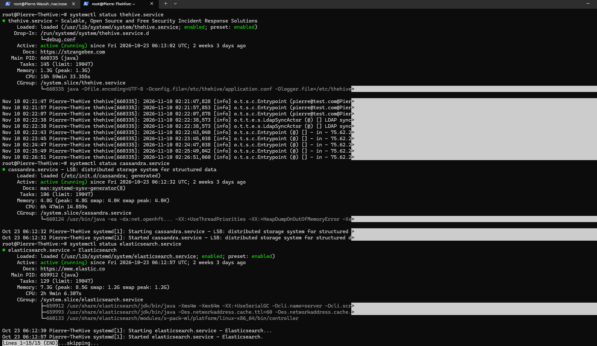
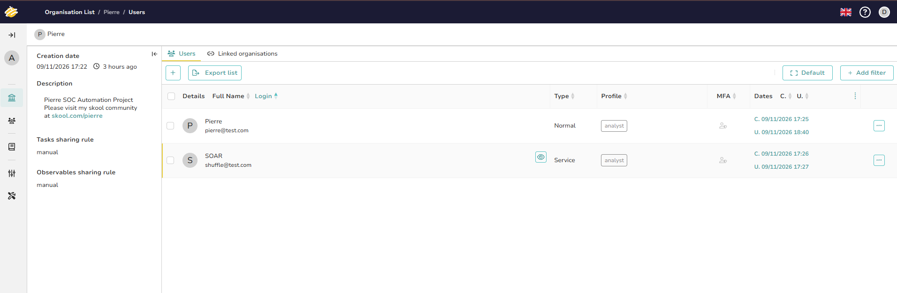

# TheHive Incident Response Platform Deployment

## Project Overview

This phase of the SOC automation project focused on deploying and configuring TheHive, an incident response and case management platform, on an Ubuntu 24.04 LTS cloud server.

The objective was to establish a centralized platform for managing security investigations and supporting automated incident response workflows.

TheHive was deployed on a separate cloud instance from Wazuh SIEM, allowing the two platforms to serve distinct roles within the SOC environment.

## Technologies Used

| Technology | Purpose |
|---|---|
| TheHive | Security incident and case management |
| Ubuntu 24.04 LTS | Linux server operating system |
| Vultr | Cloud infrastructure hosting |
| Apache Cassandra | Database infrastructure |
| Elasticsearch | Search and indexing |
| SSH | Remote server administration |
| Linux Command Line | Service management and troubleshooting |
| Shuffle SOAR | Security automation integration |

## Step 1: Cloud Server Provisioning

Provisioned an Ubuntu 24.04 LTS (64-bit) cloud instance through Vultr.

The instance was designated to host TheHive and its supporting services.

Established remote access through SSH to perform installation, configuration, and troubleshooting.

## Step 2: Apache Cassandra Configuration

Installed and configured Apache Cassandra as a supporting database service for TheHive.

Cassandra provides the data storage infrastructure required by the application.

Used Linux service management commands to verify its operational status.

Example verification command:

```bash
sudo systemctl status cassandra
```

## Step 3: Elasticsearch Configuration

Installed and configured Elasticsearch to provide search and indexing functionality.

Elasticsearch supports the retrieval and organization of information used within the incident management environment.

Verified its service status using:

```bash
sudo systemctl status elasticsearch
```

## Step 4: TheHive Installation and Configuration

Installed and configured TheHive on the Ubuntu cloud server.

Configured the application to communicate with its supporting database and search services.

After completing the configuration, verified that TheHive was accessible through its web interface.

Example service verification command:

```bash
sudo systemctl status thehive
```

## Step 5: Troubleshooting Configuration Issues

During deployment, I encountered configuration issues that prevented the supporting services from starting correctly.

I investigated the relevant Linux service statuses and configuration files to identify the source of the problem.

One issue involved a duplicate `cluster.initial_master_nodes` setting in the Elasticsearch configuration.

After correcting the configuration and restarting the affected service, I was able to continue the deployment and access TheHive.

This troubleshooting process reinforced the importance of configuration validation, service dependencies, and systematic problem-solving.

## Step 6: Shuffle SOAR Integration

Configured TheHive as part of the Shuffle SOAR incident response workflow.

The integration was designed to support the transfer of security information from the automated detection and threat intelligence process into the incident management environment.

The workflow incorporated Wazuh security alerts, SHA-256 indicators, VirusTotal API v3, and TheHive.

## Results

- Deployed TheHive on a dedicated Ubuntu 24.04 LTS cloud instance.
- Installed and configured Apache Cassandra and Elasticsearch.
- Troubleshot service configuration issues.
- Verified that TheHive was accessible through its web interface.
- Configured TheHive integration within the Shuffle SOAR workflow.

## Screenshots

### TheHive, Elasticsearch, and Cassandra Service Verification

The screenshot below demonstrates the operational status of the three services required for the TheHive incident response environment.


### TheHive Web Dashboard

The screenshot below demonstrates successful access to the TheHive incident response platform.


## Lessons Learned

This phase strengthened my understanding of Linux server administration, cloud infrastructure deployment, application dependencies, database and search service configuration, and incident response platform integration.

Troubleshooting the deployment also provided practical experience diagnosing configuration errors and resolving service startup problems.
