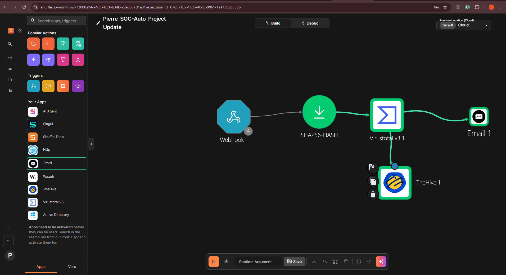
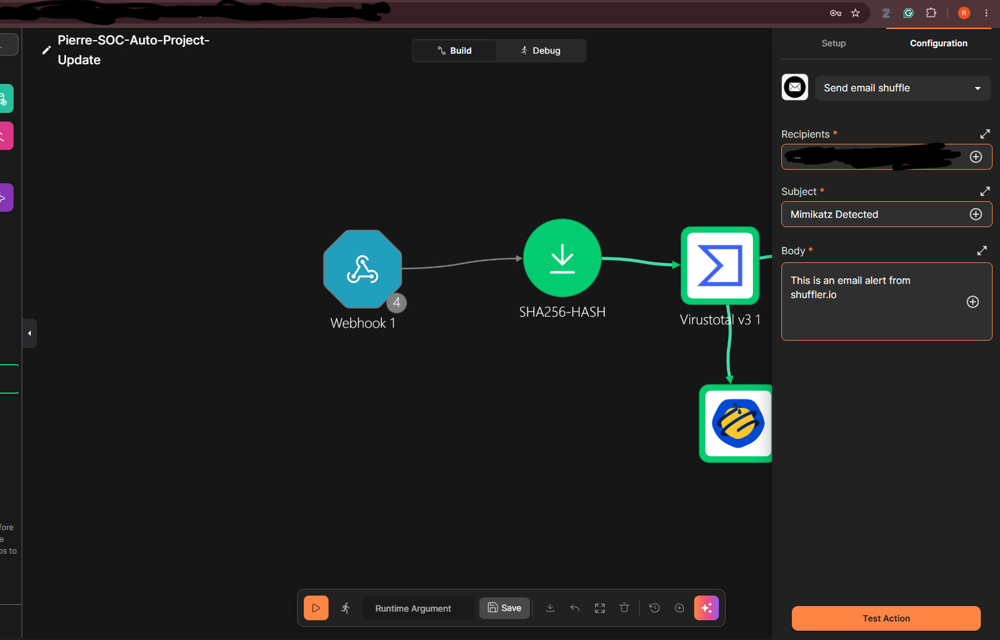
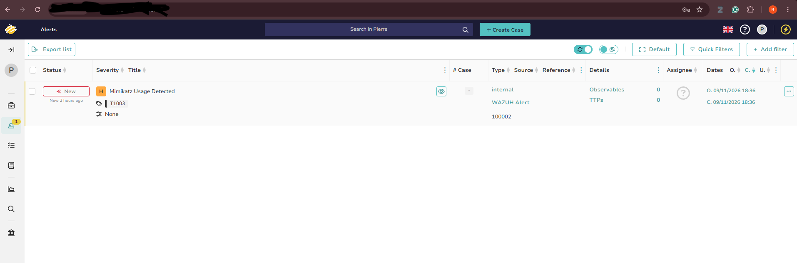
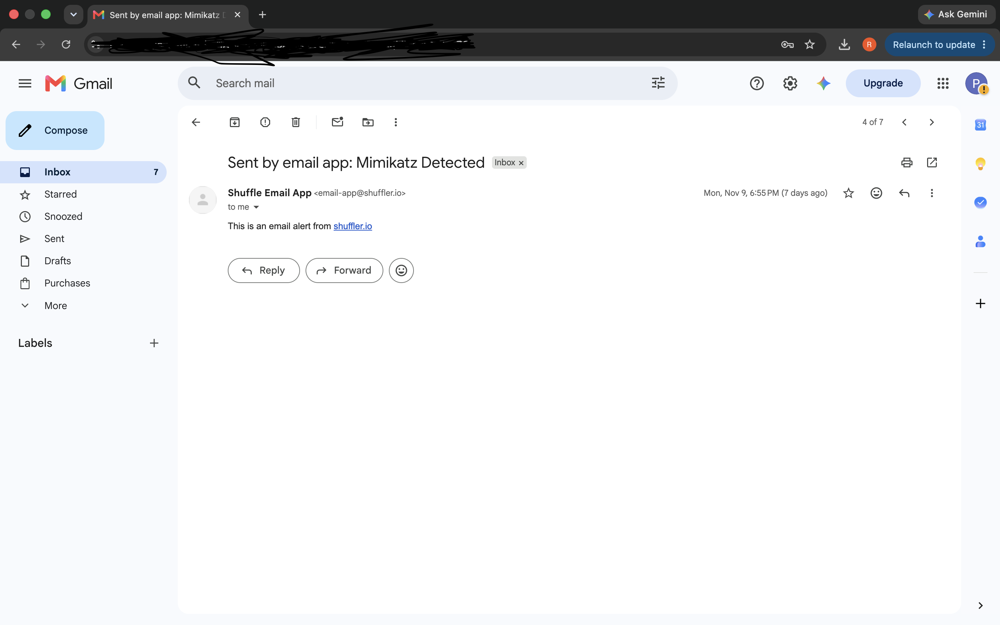

# Shuffle SOAR Automation and Threat Intelligence Integration

## Project Overview

This phase focused on implementing a Security Orchestration, Automation, and Response (SOAR) workflow using Shuffle.

The objective was to automate the processing of security alerts generated by Wazuh SIEM, enrich security indicators using VirusTotal API v3, and support incident management and notification through TheHive and email.

The workflow demonstrates how multiple cybersecurity technologies can be integrated to streamline security operations and reduce repetitive manual investigation tasks.

## Technologies Used

| Technology | Purpose |
|---|---|
| Wazuh SIEM | Security event monitoring and alert generation |
| Shuffle SOAR | Security orchestration and workflow automation |
| Webhooks | Transfer of security alerts into Shuffle |
| SHA-256 | File hash indicators for threat intelligence lookups |
| VirusTotal API v3 | File reputation and threat intelligence enrichment |
| TheHive | Incident management integration |
| Email | Automated security notifications |
| Sysmon | Windows endpoint telemetry collection |

## Automation Workflow Architecture

The workflow was designed around the following process:

1. Sysmon collects security telemetry from the Windows 10 endpoint.
2. Wazuh analyzes endpoint activity and generates security alerts.
3. A webhook forwards relevant alert information to Shuffle SOAR.
4. Shuffle processes a SHA-256 file hash indicator.
5. VirusTotal API v3 provides threat intelligence information associated with the hash.
6. TheHive integration supports incident management.
7. An email action sends an automated notification.

### Simplified Workflow

```text
Windows 10 Endpoint
        |
        v
      Sysmon
        |
        v
    Wazuh SIEM
        |
        v
    Shuffle SOAR
        |
        v
   Webhook Trigger
        |
        v
  SHA-256 Indicator
        |
        v
 VirusTotal API v3
        |
        +-------------------+
        |                   |
        v                   v
      TheHive          Email Notification
```

*This diagram is a simplified logical representation. The actual branching and execution order are shown in the Shuffle workflow screenshot.*

## Step 1: Configure the Shuffle Webhook

Created a Shuffle workflow using a webhook trigger to receive security information from Wazuh.

The webhook served as the entry point for the automation process.

This configuration enabled security alerts to initiate downstream processing within Shuffle.

## Step 2: Process SHA-256 Indicators

Configured the workflow to process SHA-256 file hash indicators associated with security investigations.

SHA-256 hashes provide a consistent identifier for files and can be used to query external threat intelligence platforms.

The extracted or supplied hash value was used as input for the VirusTotal integration.

## Step 3: Integrate VirusTotal API v3

Configured the VirusTotal API v3 integration to support automated file hash reputation lookups.

The integration was designed to retrieve threat intelligence information associated with SHA-256 indicators.

This enrichment process can help analysts determine whether a file has been previously identified as suspicious or malicious.

## Step 4: Configure TheHive Integration

Added TheHive to the Shuffle workflow to support incident management.

The integration was configured to communicate security investigation information with the incident response platform.

TheHive provides a centralized environment for organizing and managing security investigations.

## Step 5: Configure Automated Email Notifications

Configured an email notification action within Shuffle.

The notification component was designed to communicate relevant security alert information without requiring a manual email to be sent for each event.

During testing, automated email notifications were received following the processing of security alerts.

## Step 6: Validate the Automation Workflow

Performed controlled security testing within the Windows 10 virtual machine using Mimikatz.

Observed related Sysmon events and Wazuh security alerts.

Confirmed that alerts reached the Shuffle automation environment and that email notifications were generated.

The test demonstrated the operation of the endpoint monitoring, SIEM alerting, and automated notification pipeline.

## Results

- Configured a webhook-based Shuffle SOAR workflow.
- Integrated SHA-256 file hash processing.
- Configured VirusTotal API v3 for threat intelligence enrichment.
- Added TheHive integration for incident management.
- Configured automated email notifications.
- Confirmed Wazuh security alerts reached Shuffle.
- Received automated email notifications during controlled testing.

## Screenshots

## Screenshots and Workflow Evidence

### 1. Shuffle SOAR Automation Workflow

The screenshot below illustrates the Shuffle SOAR workflow integrating VirusTotal API v3 and TheHive.

The workflow was configured to process security indicators, perform threat intelligence lookups, and support incident response activities.



### 2. Automated Email Configuration

Configured an email action within Shuffle to support automated security alert notifications.

This configuration allows the workflow to communicate relevant security information through email.



### 3. TheHive Integration — Mimikatz Alert

The screenshot below demonstrates the TheHive integration associated with the controlled Mimikatz detection scenario.

This provides evidence of how security alert information was incorporated into the incident response workflow.



### 4. Automated Security Email Notification

The screenshot below shows an email notification generated through the Shuffle automation workflow.

This demonstrates that the configured notification mechanism successfully delivered security alert information.



## Lessons Learned

This phase provided hands-on experience with security orchestration, webhook integrations, API-based threat intelligence enrichment, and automated security alert notifications.

It also reinforced the importance of validating workflow execution, troubleshooting integration issues, and ensuring security information is communicated accurately between platforms.
