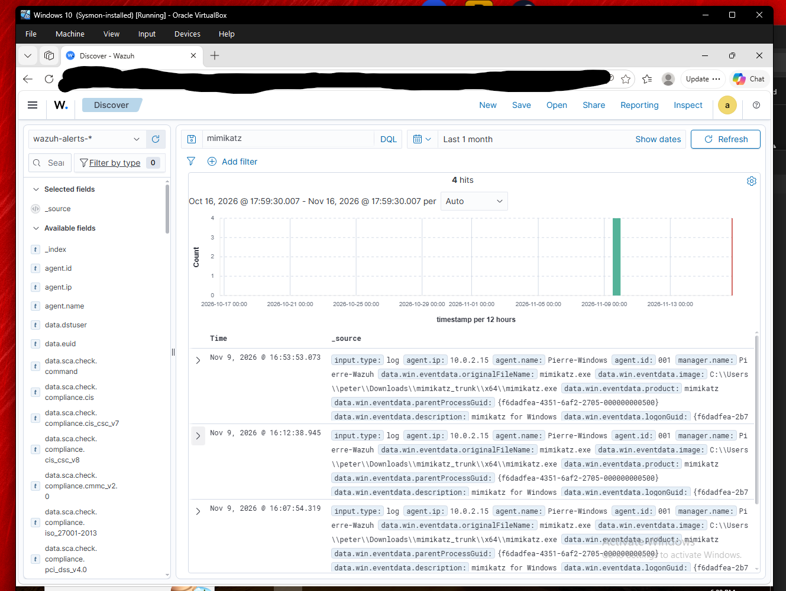
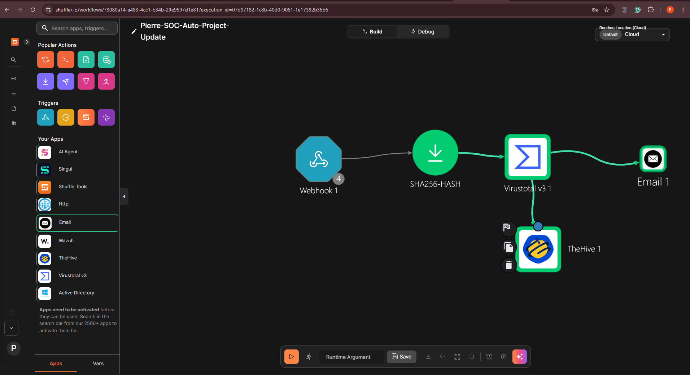
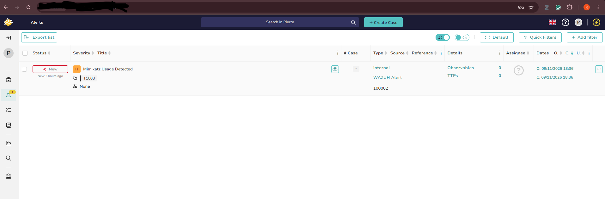
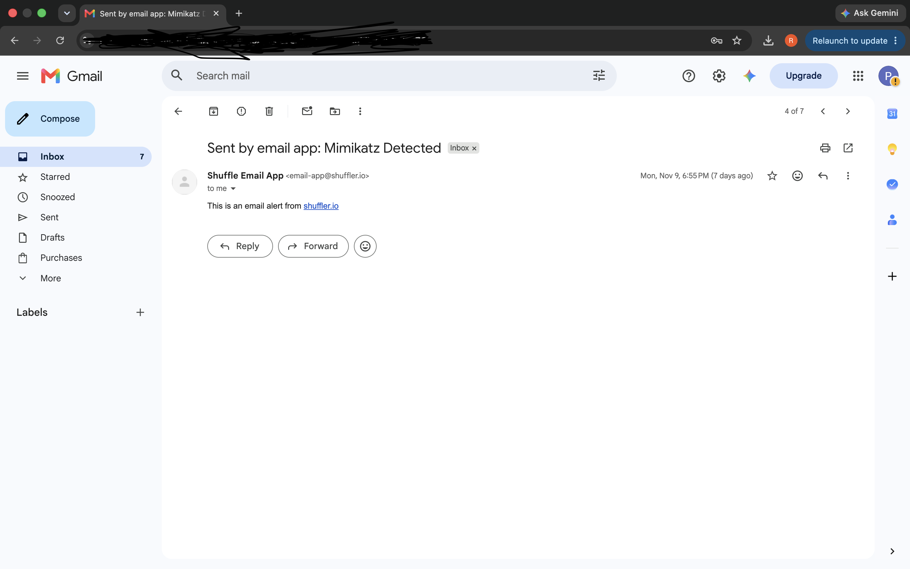

# Mimikatz Detection and Security Investigation

## Investigation Overview

This investigation was conducted as part of a controlled Security Operations Center (SOC) automation lab.

The objective was to evaluate the detection and alerting capabilities of Sysmon and Wazuh SIEM when suspicious activity associated with Mimikatz occurred within an isolated Windows 10 virtual machine.

The investigation also evaluated how security alerts could be processed through Shuffle SOAR and communicated through automated notification and incident management integrations.

## Investigation Environment

| Component | Purpose |
|---|---|
| Windows 10 Virtual Machine | Controlled testing endpoint |
| Oracle VirtualBox | Virtualization platform |
| Sysmon | Endpoint telemetry collection |
| Wazuh SIEM | Security event analysis and alert generation |
| Shuffle SOAR | Automated security workflow processing |
| VirusTotal API v3 | SHA-256 threat intelligence lookups |
| TheHive | Incident and case management |
| Email Integration | Automated security alert notification |

## Investigation Objectives

- Generate suspicious endpoint activity within a controlled environment.
- Observe corresponding Sysmon telemetry.
- Identify security alerts generated by Wazuh.
- Examine the security information associated with the detection.
- Verify alert forwarding to Shuffle SOAR.
- Document threat intelligence and incident management integrations.
- Confirm automated security notifications.

## Step 1: Controlled Security Testing

Executed the Mimikatz executable within an isolated Windows 10 virtual machine.

The test was intended to generate observable endpoint activity and evaluate the security monitoring environment.

Testing was restricted to the authorized lab environment.

## Step 2: Endpoint Telemetry Collection

Used Sysmon to collect Windows endpoint events.

Reviewed Sysmon telemetry through Windows Event Viewer:

`Applications and Services Logs → Microsoft → Windows → Sysmon → Operational`

The event logs provided visibility into activity occurring on the monitored Windows endpoint.

## Step 3: Wazuh Security Alert Investigation

Reviewed Wazuh SIEM alerts associated with the controlled Mimikatz test.

Wazuh provided centralized visibility into security events collected from the Windows environment.

The investigation focused on identifying relevant alert details and understanding how endpoint activity was represented within the SIEM.

### Investigation Evidence

The Wazuh alert screenshot documents the security detection observed during testing.

## Step 4: Shuffle SOAR Alert Processing

Verified that security alerts were forwarded from Wazuh to Shuffle SOAR.

The Shuffle workflow incorporated a webhook trigger and automated processing of security information.

This integration demonstrated how SIEM alerts could initiate downstream security automation.

### Workflow Evidence

## Step 5: VirusTotal Threat Intelligence Integration

Configured VirusTotal API v3 within Shuffle to support SHA-256 file hash reputation lookups.

The integration was intended to enrich security investigations with external threat intelligence.

The results of any individual lookup should be evaluated alongside the underlying endpoint evidence rather than treated as definitive proof of malicious activity.

## Step 6: TheHive Incident Management Integration

Configured TheHive within the Shuffle workflow to support incident management.

The integration was designed to communicate relevant investigation information to the incident response platform.

### TheHive Integration Evidence

## Step 7: Automated Security Notification

Configured an email notification action within Shuffle.

During controlled testing, automated security email notifications were received.

This confirmed that the notification component of the workflow successfully communicated security alert information.

### Notification Evidence

## MITRE ATT&CK Analysis

Mimikatz is associated with credential-access techniques, including attempts to obtain credentials from Windows systems.

MITRE ATT&CK technique **T1003 — OS Credential Dumping** is relevant background for understanding potential Mimikatz-related behavior.

However, executing the Mimikatz executable does not independently establish that credential dumping occurred.

A specific technique should only be assigned to the observed test activity when supported by event logs, process activity, or other investigation evidence.

## Investigation Results

The controlled test demonstrated:

- Endpoint event collection through Sysmon.
- Wazuh security alerts associated with Mimikatz testing.
- Alert forwarding into Shuffle SOAR.
- Integration of SHA-256 indicator processing and VirusTotal API v3.
- Configuration of TheHive incident management integration.
- Successful delivery of automated email notifications.

## Lessons Learned

This investigation provided hands-on experience with endpoint security monitoring, SIEM alert analysis, threat intelligence integration, and security workflow automation.

It also reinforced the importance of correlating endpoint events with SIEM alerts and validating automated workflow outcomes before drawing conclusions about detected threats.

## Future Improvements

Potential enhancements include:

- Documenting specific Sysmon event IDs and Wazuh rule IDs.
- Recording alert timestamps and investigation timelines.
- Analyzing additional controlled security scenarios.
- Expanding MITRE ATT&CK mapping based on observed telemetry.
- Measuring workflow execution outcomes.
- Developing more detailed incident investigation reports.
## Custom Wazuh Detection Engineering

To improve threat detection capabilities, I developed and implemented a custom Wazuh SIEM rule designed to identify Mimikatz execution on a monitored Windows 10 endpoint.

### Detection Rule Configuration

The custom rule was configured with the following parameters:

| Parameter | Configuration |
|---|---|
| Rule ID | 100002 |
| Severity Level | 15 |
| Event Source | Sysmon Event ID 1 |
| Detection Method | PCRE2 Pattern Matching |
| Target Executable | mimikatz.exe |
| MITRE ATT&CK Technique | T1003 — OS Credential Dumping |
| MITRE ATT&CK Tactic | Credential Access |

### Detection Logic

The rule monitors Windows process creation telemetry collected by Sysmon.

It examines the `win.eventdata.originalFileName` field and uses case-insensitive pattern matching to identify Mimikatz-related execution.

When the detection criteria are met, Wazuh generates a Level 15 security alert.

### Detection Validation

To validate the rule, I executed Mimikatz within an isolated Windows 10 virtual machine.

The test successfully generated a Wazuh alert containing:

- Rule ID 100002
- Mimikatz Usage Detected
- Severity Level 15
- Executable filename and command-line information
- Process and parent-process identifiers
- File hash information
- MITRE ATT&CK T1003 mapping

### SOAR Integration

The Wazuh Manager was configured to forward alerts associated with Rule ID 100002 to Shuffle SOAR through a webhook integration.

This enabled the custom detection rule to participate in the automated security alert processing and notification workflow.

### Results

Successfully developed, deployed, and validated a custom SIEM detection rule using Windows endpoint telemetry.

The implementation demonstrates practical experience in detection engineering, security event analysis, MITRE ATT&CK mapping, and SIEM-to-SOAR integration.

**Note:** Automated blocking or process termination was not validated as part of this detection test.
